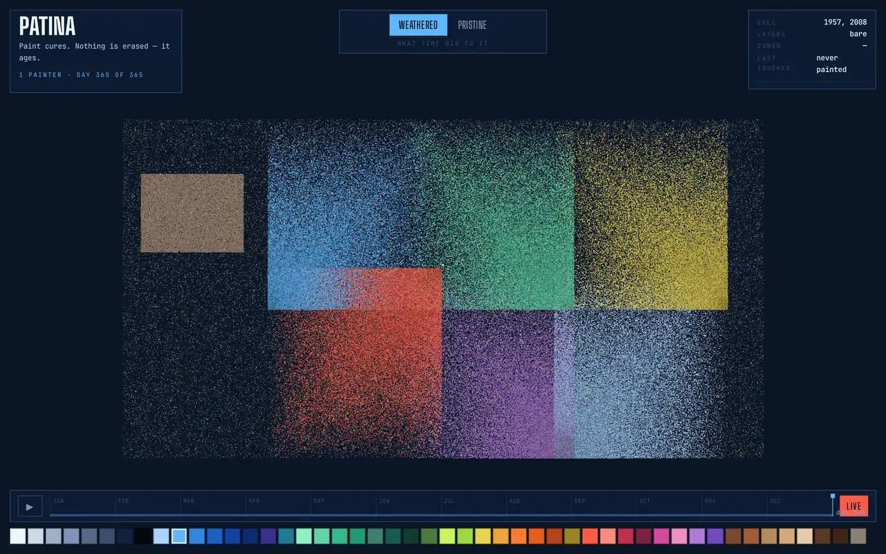

<div align="center">



# Patina

**Paint cures. Nothing is erased, it ages.**

[Try it](https://patina.futile.studio) · [Futile Studio](https://futile.studio)


</div>

> **Futile Lab** · experiment, canvas · live since Sep 2026

## Overview

A shared canvas that runs for a year. 4096 × 4096 cells, one pixel at a time, no account. The twist is the medium: r/place rewards whoever clicked last, and this doesn't.

## The rule

A cell you painted ten seconds ago is **wet**. Paint over it and your colour lands almost whole.

A cell nobody has touched for a week has **cured**. Paint over it and 8% of your colour lands. Turning a cured wall takes about a dozen committed placements, and the cooldown is twenty seconds.

Two things fall out of that, and both are the point:

- **Attacking softens the wall for everyone.** Landing a hit on week-old paint resets its cure clock. So you've also made it cheap for its owner to take it straight back. Every raid hands the defender one free swing.
- **Defence is patience, not clicking.** You can't out-click a wall into existence. You paint it, then you leave it alone, and time does the work.

Nothing is ever deleted. Cells that get fought over **oxidise**: warm colours drift toward rust, cool ones toward verdigris, in proportion to how many times they've changed hands. Cells nobody returns to **fade** toward the board, but only part-way. A ghost is still a record. After a year you can read a region's whole history off its surface: which borders were wars, which murals were loved and then abandoned.

## Two readings of the same year

The canvas keeps one append-only log of placements, and everything is a fold of it. So it can show you the same history twice:

- **Weathered:** what time did to it. Curing, oxidation, fade. The real canvas.
- **Pristine:** what the painters meant. Every placement lands whole, nothing ages.

The pristine layer isn't a second canvas people paint on. It's the same events replayed with the medium switched off. The gap between the two is the only thing here worth looking at twice.

## The year

A timeline runs across the bottom, ticked into twelve months. Drag to any day and the canvas rewinds to what it looked like then, in both readings. Press **▶** and the whole year plays back as footage, territories creeping out from their corners and colliding somewhere around August.

Playback doesn't download a year of stills. The relay buckets the log into frames, keeps the last placement per cell per bucket, and ships that. The page folds it with the same code the relay folds its log with. A year is a few hundred KB and it replays in both modes from one request.

## The paint box

48 colours in six families of eight: a neutral ramp, the studio blues, greens, yellows through oranges, reds and violets, and the earths the oxidation pulls everything toward. No eraser. `npm test` asserts every swatch sits at least 25 apart in RGB from every other one and from the board itself, so there are no dead slots and no way to paint something invisible.

The log stores RGB rather than a palette index, so the palette can grow or be reordered without reinterpreting a placement that already happened.

## Controls

| Input | Does |
| :-- | :-- |
| drag / scroll | pan, zoom |
| click | place (20s cooldown) |
| hover | layers, cure %, last touched |
| `space` | play the year |
| `w` / `p` | weathered or pristine |
| `f` / `shift-F` | frame the paint / the whole board |
| `←` `→` | a day back or forward (`shift` for a month) |

## Stack

Astro for the one page, a plain Node relay, `ws`, no framework and no database. The relay serves the built page, the scrub and reel endpoints (`/at`, `/reel`), `/health` and the socket (`/ws`) from one origin.

## How it's built

**`shared/patina.js`** is the whole mechanic (curing, oxidation, fade, and the renderer) as pure functions. The relay folds its log with it and the browser folds playback with it. So a scrubbed month on a phone and the live canvas on a laptop are the same arithmetic, not two implementations that agree for now.

**Nothing is dense.** 4096² is 16.7 million cells. Stored as arrays that's 200 MB, which no browser will hold and no socket will ship. Only painted cells take up room (16 bytes each), so the board's size costs nothing until people use it. A canvas that's 1.8% painted ships in 4.7 MB before compression. There's also no bitmap of the board anywhere: the renderer stamps painted cells straight into a screen-sized buffer.

**`data/events.bin`** is the only source of truth: fixed 12-byte records, appended synchronously before the placement is acknowledged. Delete it and you have a new year. The `data` volume is the whole backup story.

A few guard rails on the relay: the placement cooldown is keyed on an address the client can't set, reels are limited to 10 a minute per visitor, and an oversized socket frame closes that socket instead of crashing the server.

## Running it locally

Needs Node 22.12 or newer.

```sh
npm install
npm run seed     # optional: a fabricated year, so there's something to look at
npm run dev
```

`npm run dev` runs Astro with hot reload on 4321 and the relay on 4323 together. In production there is only the relay, serving the built page too:

```sh
npm run build
npm start
```

Tests are `node --test` and cover the things that would fail silently: the calibration of the mechanic, the wire format the client decodes by hand, and the cooldown.

```sh
npm test
```

`npm run loadtest` starts its own server on a spare port with a copy of `data/` and throws 1000 painters at it (pass a number to change that). Seed first for a realistic canvas.

## Configuration

| Variable | Purpose |
| :-- | :-- |
| `PORT` | Relay port, default `4323` |
| `PATINA_DATA` | Where the event log lives, default `./data` |

## Deploying

The live site runs from a Docker image. Every push to `main` builds it, pushes it to GHCR as `ghcr.io/mayurjivani/patina` and triggers a redeploy in Coolify (`.github/workflows/image.yml`). The Coolify service is `deploy/compose.yaml`: host network, read-only filesystem, no capabilities, and the log mounted from the host. `deploy/deploy.sh` sets up the box side (state directory and the Caddy site block) and never builds or restarts anything.

Anywhere else, `docker-compose.yml` brings up the relay with its own Caddy and gets its own certificate (edit `Caddyfile` for your hostname):

```sh
docker compose up -d --build
```

`docker-compose.tunnel.yml` plus `sudo deploy/install.sh` is the older setup for a box that already runs cloudflared in front of a system Caddy. `install.sh` is re-runnable and validates the Caddyfile before reloading it. The tunnel's ingress has to point at `http://localhost:80` in the Cloudflare dashboard, and that half can't be done from the box.

Whichever way you run it, keep the data volume. Without it a redeploy is a blank canvas.

## The honest caveat

At 4096² a young canvas looks empty, because it is. The page opens framed on wherever the paint actually is rather than on the whole sheet, which makes it usable. But a board this size wants real traffic before it reads as a place rather than a smudge. 1024² would look better sooner. The size is a deliberate bet that it fills.

## Licence

No licence file yet, all rights reserved.

---

<p align="center"><sub>Built by <a href="https://github.com/MayurJivani">Mayur Jivani</a> at <a href="https://futile.studio">Futile Studio</a>. Everything is futile. Do it anyway.</sub></p>
